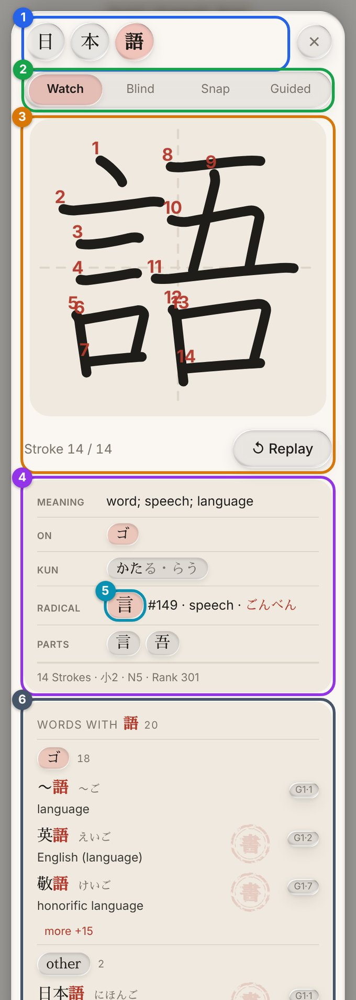
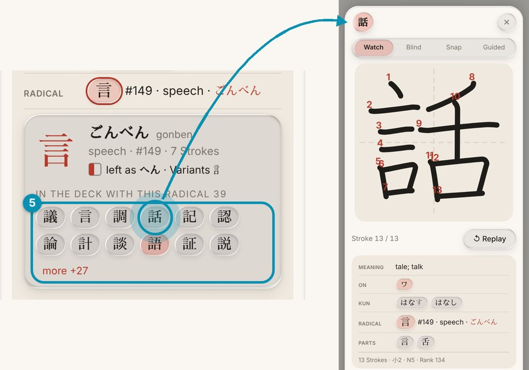
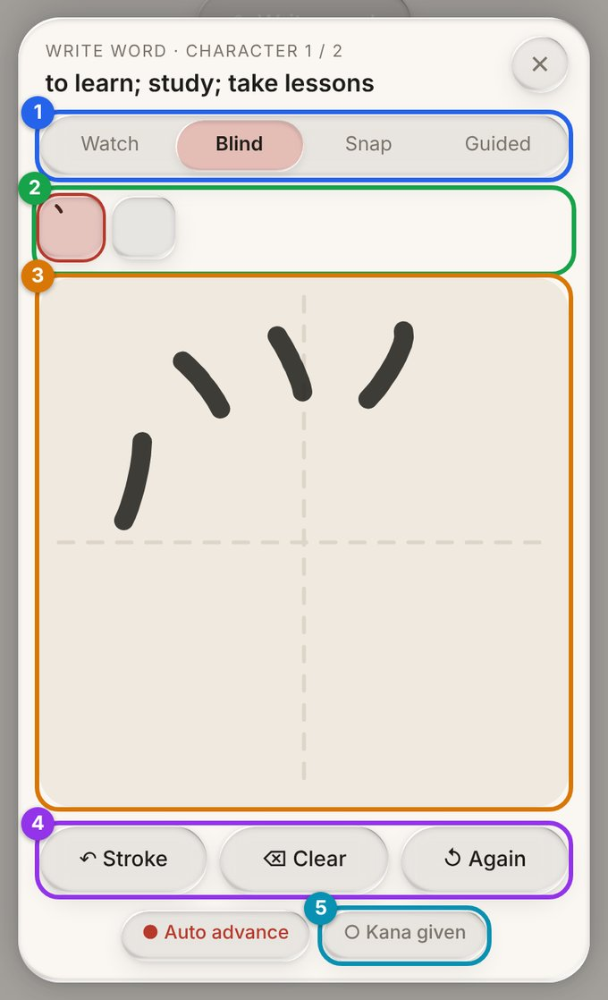

 

  <h1 align="center">日本語 · jp-anki-deck</h1>

  

    An Anki deck for learners of Japanese, built around <strong>Genki</strong> and <strong>Tobira</strong>, with a kanji popup, stroke order and writing practice.
     
    German and English, works offline, also on your phone.
     
     
    <a href="https://github.com/TheReCeX/jp-anki-deck/releases"><strong>Download the deck »</strong></a>
     
     
    <a href="https://ankiweb.net/shared/info/1607352118">Add-on</a>
    &middot;
    <a href="https://github.com/TheReCeX/jp-anki-deck/issues/new">Report Bug</a>
    &middot;
    <a href="https://github.com/TheReCeX/jp-anki-deck/issues/new">Request Feature</a>
  

  
  
  

  
Table of Contents

  <ol>
    <li><a href="#about-the-project">About The Project</a>
      <ul><li><a href="#built-with">Built With</a></li></ul>
    </li>
    <li><a href="#getting-started">Getting Started</a></li>
    <li><a href="#usage">Usage</a></li>
    <li><a href="#limitations">Limitations</a></li>
    <li><a href="#roadmap">Roadmap</a></li>
    <li><a href="#structure">Structure</a></li>
    <li><a href="#contributing">Contributing</a></li>
    <li><a href="#license">License</a></li>
    <li><a href="#acknowledgments">Acknowledgments</a></li>
  </ol>

## About The Project

  
  &nbsp;
  

 

A vocabulary deck for learners of Japanese, especially students of Japanese studies at the Friedrich-Alexander-University Erlangen-Nuernberg. It is built for the vocabulary of **Genki 1, Genki 2 and Tobira** (about 3,700 words), with cards in both directions (recognition and recall).

> **Status:** The Genki and Tobira vocabulary is **not included yet**. Release v1.0 contains the card templates, the build tooling and 14 example words, so you can see and try everything. The full vocabulary will be added as soon as the licensing of some of its meanings is clarified (see [Roadmap](#roadmap)).

What makes it special is the card itself:

* **Kanji popup:** Tap a kanji on the back of a card. You get the animated stroke order, meaning, on and kun readings, radical, components, school grade and JLPT level.
* **Writing practice:** Four modes (Watch, Blind, Snap, Guided) right in the card. Not graded, and it does not affect Anki scheduling.
* **Radicals and word list:** Tap a radical to see all kanji of the deck that use it. Below each kanji you find the words of the deck that contain it.
* **Bilingual:** German and English, switchable. If one language is missing, the card shows the other.
* **Settings inside the card:** Rōmaji or furigana, accent color, sizes, width, font. Changes apply immediately.
* **Offline and mobile:** No internet connection needed. The desktop add-on is optional.

(<a href="#readme-top">back to top</a>)

  

(<a href="#readme-top">back to top</a>)

## Getting Started

### Import the deck

1. Download the `.apkg` file from [Releases](https://github.com/TheReCeX/jp-anki-deck/releases). Release v1.0 contains example words only.
2. Open it by double-click, or in Anki via *File → Import*.
3. On a computer, tick **"Import any deck presets"** (wording may vary by Anki version). This applies the intended options.
4. Study through the top-level deck **Japanisch**. The guide card appears first, the example words are in `Japanisch::Beispiel`.

On iPhone, iPad and Android, import the file into the respective Anki app.

### Add-on (optional)

The **Kanji-Wortindex** add-on keeps the word list in the kanji popup up to date when you add your own vocabulary. Everything works without it, the list is just static then.

1. In Anki: *Tools → Add-ons → Get Add-ons*
2. Enter the code: `1607352118`
3. Restart Anki

The index syncs via media, so it is up to date on your phone as well.

(<a href="#readme-top">back to top</a>)

## Usage

The **guide card** in the deck explains everything (later available in the browser under the tag `Anleitung`):

* Cards: recognition (Japanese → meaning) and recall (meaning → Japanese)
* Settings via the slider icon in the top right
* Kanji popup, radical card and writing modes with numbered figures
* Adding your own cards (until the vocabulary is included, this is how you fill the deck): fields `Expression`, `Reading` (Anki format `東京[とうきょう]`), `Bedeutung` (German), `Meaning` (English)

(<a href="#readme-top">back to top</a>)

## Limitations

- Rōmaji is generated automatically. A rule detects the particles は and へ, in rare cases it gets them wrong.
- Some kanji have no stroke data, for example variants like 麵.
- The `Reading` field must be in furigana format, otherwise readings cannot be matched to kanji.
- The German kanji meanings are translated from English.
- JLPT levels are unofficial, there have been no official kanji lists since 2010.

(<a href="#readme-top">back to top</a>)

## Roadmap

- [x] Card templates, kanji popup, writing modes, radical cards
- [x] Build tooling: deck from plain files and back (`scripts/`)
- [ ] Genki 1, Genki 2 and Tobira vocabulary (about 3,700 words), pending clarification of the Wadoku data license
- [ ] Update this README, the guide card and the changelog once the vocabulary is included

## Structure

| Folder | Contents |
|---|---|
| [`templates/`](templates/) | Card templates (HTML, CSS, JS) |
| [`addon/`](addon/) | Source code of the Kanji-Wortindex add-on |
| [`scripts/`](scripts/) | Scripts to export a deck to plain files and to build it again |
| [`data/`](data/) | Notes (example words, guide card), decks and presets |
| [`media/`](media/) | Kanji data files and font used by the cards |
| [`docs/`](docs/) | Figures and documentation |
| [`LICENSES/`](LICENSES/) | Full texts of all licenses |

The finished deck is not stored in the repository but published under [Releases](https://github.com/TheReCeX/jp-anki-deck/releases). To build it yourself: `pip install anki zstandard`, then `python scripts/build.py` (see [`scripts/README.md`](scripts/README.md)).

(<a href="#readme-top">back to top</a>)

## Contributing

Bug reports, ideas and translation corrections are welcome, ideally via an [issue](https://github.com/TheReCeX/jp-anki-deck/issues/new). Pull requests are welcome too:

1. Fork the project
2. Create your feature branch (`git checkout -b feature/new-feature`)
3. Commit your changes (`git commit -m 'Add new feature'`)
4. Push to the branch (`git push origin feature/new-feature`)
5. Open a pull request

(<a href="#readme-top">back to top</a>)

## License

Licensed under **CC BY-SA 4.0** unless noted otherwise. Exceptions:

| Part | License |
|---|---|
| Font Sawarabi Mincho | SIL Open Font License 1.1 |
| Meanings taken from Wadoku (planned Genki/Tobira vocabulary, not part of the current release) | Wadoku.de data license 1.0: **free and non-commercial distribution only, the license must accompany it** |
| Genki and Tobira content (planned, not yet included) | Rights held by authors and publishers, not licensed |

The current release contains no Wadoku-derived text and no Genki or Tobira word lists. The license rows above will apply once the vocabulary is added. Details in [`LICENSE`](LICENSE), full texts in [`LICENSES/`](LICENSES/). The deck must not be sold. This project is not affiliated with the publishers of Genki and Tobira.

(<a href="#readme-top">back to top</a>)

## Acknowledgments

This deck builds on free data. Many thanks to:

* [KanjiVG](https://kanjivg.tagaini.net) for the stroke data
* [KANJIDIC2](https://www.edrdg.org/wiki/index.php/KANJIDIC_Project) (EDRDG) for kanji information
* [Wadoku](https://www.wadoku.de) for the Japanese-German dictionary (basis of the planned vocabulary)
* [Jonathan Waller](https://www.tanos.co.uk/jlpt/) for the JLPT lists
* [BabelStone IDS](https://www.babelstone.co.uk/CJK/IDS.TXT) by Andrew West for kanji structure
* [Sawarabi Mincho](https://github.com/googlefonts/sawarabi-mincho/) for the font

All sources with licenses: [`CREDITS.md`](CREDITS.md).

(<a href="#readme-top">back to top</a>)

<!-- MARKDOWN LINKS & IMAGES -->
[anki-badge]: https://img.shields.io/badge/Anki-2B6CB0?style=for-the-badge
[anki-url]: https://apps.ankiweb.net
[html-badge]: https://img.shields.io/badge/HTML5-E34F26?style=for-the-badge&logo=html5&logoColor=white
[html-url]: https://developer.mozilla.org/docs/Web/HTML
[css-badge]: https://img.shields.io/badge/CSS3-1572B6?style=for-the-badge&logo=css3&logoColor=white
[css-url]: https://developer.mozilla.org/docs/Web/CSS
[js-badge]: https://img.shields.io/badge/JavaScript-F7DF1E?style=for-the-badge&logo=javascript&logoColor=black
[js-url]: https://developer.mozilla.org/docs/Web/JavaScript
[py-badge]: https://img.shields.io/badge/Python-3776AB?style=for-the-badge&logo=python&logoColor=white
[py-url]: https://www.python.org
